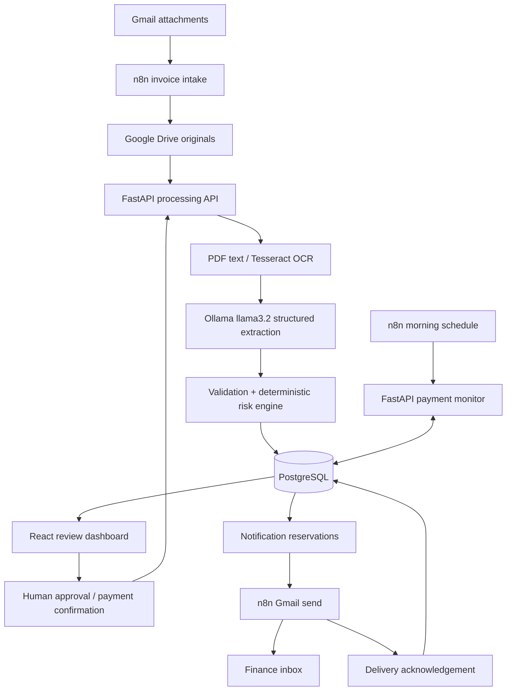
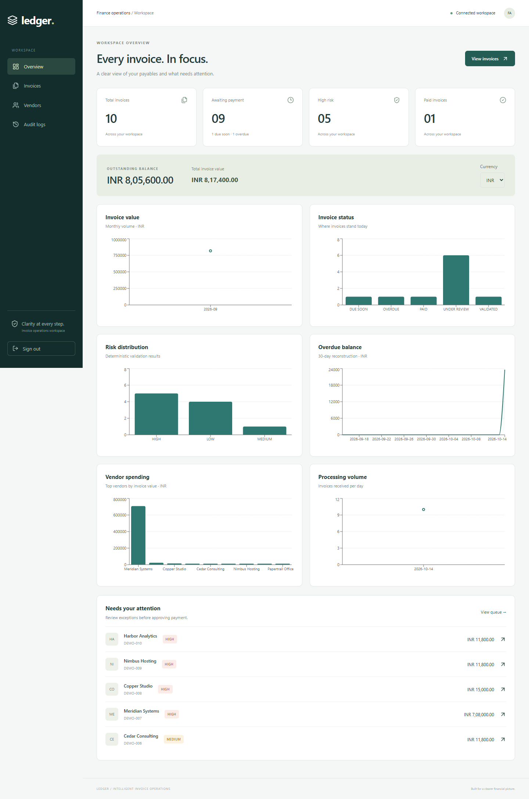

# Ledger — Intelligent Invoice Processing & Payment Automation

A working finance-operations portfolio application: invoice intake, document extraction, deterministic validation, human review, payment tracking, and audited reminders. The React interface is branded **Ledger**.

Manual invoice handling scatters documents across email, spreadsheets, and payment records. This project brings those steps into one traceable process, while keeping uncertain AI output behind explicit review and approval gates.

## Quick start

Clone this repository, then follow the Docker setup below:

```sh
git clone https://github.com/anitej299/invoice-automation.git
cd invoice-automation
```

Install Ollama on the host, run `ollama pull llama3.2`, and keep Ollama running before processing invoices. No OpenAI API key is needed. Commands below assume the repository root; skip any repeated `cd invoice-automation` after cloning.

**Documentation:** [Architecture](docs/architecture.md) · [API](docs/api.md) · [Google/n8n setup](n8n/README.md) · [Operations](docs/operations.md) · [Demo](docs/demo.md) · [Verification](docs/verification.md) · [Contributing](CONTRIBUTING.md)

**Docker Desktop users:** open the frontend at <http://localhost:8080> and the backend API docs at <http://localhost:8000/docs>. Port 5173 belongs to the separate local development server. On Windows, run `powershell -ExecutionPolicy Bypass -File .\Start-Docker.ps1` from this directory to stop any managed local preview and start the containers in dependency order. Wait for Docker Desktop's Linux engine to finish starting first.

For the already-configured Windows workspace, start both local services together:

```powershell
cd invoice-automation
powershell -ExecutionPolicy Bypass -File .\Start-Local.ps1
```

Open <http://127.0.0.1:5173> for the frontend and <http://127.0.0.1:8000/docs> for backend API documentation. The launcher checks both the backend and frontend API proxy before reporting success. It runs independently of the chat session and writes logs to `.local/backend.stderr.log` and `.local/frontend.stderr.log`. To stop both services before using Docker, run `powershell -ExecutionPolicy Bypass -File .\Stop-Local.ps1`. On a fresh checkout, first create `.env` and install local dependencies as described below.

Requires Docker Desktop with its Linux engine running, Docker Compose, and Python 3.10+ for the environment helper.

```powershell
cd invoice-automation
python scripts/setup_env.py
docker compose up --build -d
docker compose exec backend python -m app.db.seed --demo
```

`setup_env.py` creates `.env` with random local secrets and does not overwrite an existing file. If this workspace already has `.env`, skip that command. Read `SEED_ADMIN_EMAIL` and `SEED_ADMIN_PASSWORD` in that file to sign in; they are never hardcoded in source. Change `FINANCE_EMAIL` before enabling email workflows.

- Dashboard: <http://localhost:8080>
- Interactive API documentation: <http://localhost:8000/docs>
- OpenAPI schema: <http://localhost:8000/openapi.json>
- n8n: <http://localhost:5678>

The backend starts with Alembic migrations and admin-user initialization. Demo seeding is explicit and runs only against an empty invoice database. `docker compose down` preserves both database and n8n volumes; avoid `down -v` unless you intentionally want to delete data.

## What is implemented

- Gmail intake with multiple attachments, Drive archival, bounded PDF/image OCR, and one-invoice failure isolation.
- Tesseract provider abstraction with native PDF text extraction before image OCR.
- Local Ollama (`llama3.2`) structured extraction, Pydantic validation, confidence, and a reusable prompt. An optional OpenAI-compatible adapter remains available.
- Required-field, date, total, duplicate, similarity, PO, amount, and confidence rules using Decimal arithmetic.
- LOW/MEDIUM/HIGH risk with human-readable reasons and explicit approval gates.
- PostgreSQL schema, frozen Alembic migration, Argon2 passwords, JWT login, and separate automation credentials.
- Filtered, sorted, paginated APIs; dashboard, invoice review/editing, uploads, vendors, audit trail, and reminders.
- Daily payment monitoring, finance reminders, high-risk alerts, and an authenticated payment-confirmation webhook.
- Ten fictional PDFs, extraction fixtures, repeatable seed data, backend tests and basic UI tests.

Payment automation here tracks confirmed payments and sends reminders. It does not initiate bank transfers or infer payment from an untrusted email. Manual uploads process files directly; Gmail intake also archives the original in Drive.

## Architecture and stack



Backend: Python, FastAPI, SQLAlchemy, Pydantic, Alembic, PostgreSQL. Frontend: React, TypeScript, Vite, Tailwind CSS, Axios, React Router, Recharts. Automation: n8n and Google OAuth. Runtime: Docker Compose with persistent PostgreSQL and n8n volumes.

See [architecture](docs/architecture.md) for transactions, idempotency, state transitions, concurrency, and deliberate tradeoffs.

## Repository layout

```text
invoice-automation/
  frontend/src/{components,pages,services,hooks,types}/
  backend/app/{api,core,db,models,schemas,services}/
  backend/alembic/versions/0001_initial.py
  backend/tests/
  n8n/workflows/{invoice_intake,payment_monitoring,high_risk_alert,payment_update}.json
  sample_data/                    # 10 PDFs and JSON extraction fixtures
  scripts/                        # environment, workflow and sample helpers
  docs/                           # architecture, API, operations and demo guide
  docker-compose.yml
  .env.example
```

## Configuration

Copy `.env.example` if configuring manually, or use the generator above. Required secrets are `POSTGRES_PASSWORD`, `JWT_SECRET`, `AUTOMATION_API_KEY`, `SEED_ADMIN_PASSWORD`, and `N8N_ENCRYPTION_KEY`. The first three generated values are URL-safe hex; URL-encode manually chosen database passwords when constructing a database URL. JWT and automation keys must be at least 32 characters; the seed password must be at least 12.

| Setting | Purpose |
|---|---|
| `DATABASE_URL` | SQLAlchemy connection for local commands; Compose constructs the container URL from `POSTGRES_*` |
| `EXTRACTION_PROVIDER=ollama` | Default: local Ollama extraction; no API key |
| `OLLAMA_MODEL=llama3.2` | Model installed with `ollama pull llama3.2` |
| `OLLAMA_BASE_URL` | Local Python uses `http://127.0.0.1:11434` |
| `OLLAMA_DOCKER_BASE_URL` | Docker backend uses `http://host.docker.internal:11434` |
| `OLLAMA_TIMEOUT_SECONDS=120` | Local inference request timeout |
| `EXTRACTION_PROVIDER=local` | Credential-free, labeled-field sample parser; always adds a manual-review warning |
| `EXTRACTION_PROVIDER=openai` | Real structured LLM extraction using `OPENAI_API_KEY`, `OPENAI_MODEL`, `OPENAI_BASE_URL` |
| `OCR_PROVIDER=tesseract` | Local OCR; installed in the backend container |
| `HIGH_VALUE_THRESHOLD=100000` | Flags high value; more than five times threshold is HIGH risk |
| `TOTAL_TOLERANCE=0.01` | Decimal arithmetic tolerance |
| `MIN_EXTRACTION_CONFIDENCE=0.75` | Important-field confidence cutoff |
| `DUE_SOON_DAYS=7` | Payment monitoring window |
| `TIMEZONE=Asia/Kolkata` | Business date for monitoring and reminder uniqueness |
| `FINANCE_EMAIL` | All automated reminders/alerts go to this internal recipient |
| `MAX_UPLOAD_MB`, `MAX_PDF_PAGES` | Document resource limits |

`OCR_API_KEY` reserves configuration for future provider adapters. Document AI, Textract, and Azure adapters are not implemented; unsupported provider names fail visibly into review. `GMAIL_*`, `GOOGLE_DRIVE_*`, and `GOOGLE_DRIVE_FOLDER_ID` document the deployment's integration configuration; enter those values in n8n credentials/nodes, not in workflow JSON. n8n does not automatically import them from this file.

`N8N_USER` and `N8N_PASSWORD` are listed for deployment bookkeeping only. Modern n8n uses its first-run owner-account setup; these variables do not enable legacy basic authentication. Set a separate Header Auth credential for the payment webhook.

## Gmail, Google Drive and n8n setup

1. In Google Cloud, create a project and enable Gmail API and Google Drive API.
2. Configure the OAuth consent screen; add your test account if the app is in testing mode.
3. Create an OAuth web client. Use the exact callback URL shown by n8n, normally `http://localhost:5678/rest/oauth2-credential/callback` locally.
4. In n8n, create Gmail OAuth2 and Google Drive OAuth2 credentials using that client. Grant only the access needed by the selected nodes.
5. Create a private invoice folder in Drive. Import the four JSON workflows and select credentials on every Gmail/Drive node. Replace `REPLACE_WITH_INVOICE_FOLDER_ID` in the intake workflow.
6. Create an **HTTP Header Auth** credential with name `X-Automation-Key` and value from `.env`. Select it on every Backend HTTP node.
7. Create a separate **Header Auth** credential on the payment webhook (for example `X-Payment-Webhook-Key`) and give its secret only to the trusted payment-confirmation caller.
8. Run workflows manually first, inspect outputs, then activate intake, monitoring, and risk alerts. These send real email when activated.

Detailed node behavior, retries, imports and failure reconciliation: [n8n/README.md](n8n/README.md). No OAuth account is connected automatically by the repository.

## OCR and LLM operation

Text PDFs work without Tesseract on the host. Image invoices and scanned PDF pages need the Tesseract executable on PATH; the Docker image already installs it. The provider interface is `OCRProvider.extract(content, filename)`. PDF pages, image dimensions, upload size, extraction length, OCR timeout, and HTTP timeout are bounded.

Ollama is the default extraction provider. Keep Ollama running on the Windows host and install the requested model:

```powershell
ollama pull llama3.2
```

The backend uses Ollama's native `/api/chat` endpoint, disables streaming, passes the invoice JSON schema via `format`, and validates the returned JSON with Pydantic. Docker connects through `host.docker.internal`; localhost inside a container would point to that container. No OpenAI key is required. The local model input is bounded to 4,000 UTF-8 bytes with an 8,192-token context and 2,048-token output limit; oversized invoices or incomplete responses go to review instead of being silently truncated. A small evaluation batch and `keep_alive=0` reduce memory pressure alongside Docker and unload the model after each request. Keep the default 120-second timeout below the frontend/proxy timeout.

For deterministic offline tests, `EXTRACTION_PROVIDER=local` supports `field_name: value` lines and `item: description | quantity | unit_price | tax | amount`. This parser always requests review. `EXTRACTION_PROVIDER=openai` remains an optional alternative requiring its own key. After changing provider configuration, rebuild/recreate the backend:

```powershell
docker compose up --build -d --wait backend frontend
```

The prompt treats invoice text as untrusted data, requests null for missing values, preserves identifiers/currency, and asks for confidence. Failed OCR, provider timeouts/refusals and malformed responses become persisted UNDER_REVIEW invoices and FAILED jobs. Provider response bodies and secrets are not copied into errors.

## Tests and local development

Python 3.13 and Node 22.12+ (22 LTS) or Node 24 LTS are suitable. The checked-in package lock fixes the resolved frontend dependencies; the backend Docker image installs `requirements.lock.txt`. If npm 10 fails with an `edgesOut` resolver error when changing dependencies, use `npx --yes npm@11.13.0 install`.

```powershell
cd invoice-automation
python -m venv .venv
.venv\Scripts\python -m pip install -r backend/requirements-dev.txt
cd backend
..\.venv\Scripts\python -m pytest -q
..\.venv\Scripts\python -m compileall -q app
cd ../frontend
npm ci
npm run typecheck
npm test
npm run build
cd ..
python scripts/validate_workflows.py
docker compose config --quiet
```

If Windows `venv` cannot bootstrap pip, use `python -m pip --python .venv/Scripts/python.exe install -r backend/requirements-dev.txt`. On macOS/Linux replace `.venv\Scripts\python` with `.venv/bin/python`.

For a local SQLite demo, use the helper (loads `.env`, migrates, seeds, and serves on port 8000):

```powershell
.venv\Scripts\python scripts/run_local.py
# In a second terminal:
cd frontend
npm run dev
```

Vite proxies `/api` to localhost:8000; Docker's nginx proxies it to backend:8000. SQLite is a test/development convenience. PostgreSQL remains the deployment database and is needed to exercise row locks and multi-worker concurrency.

Migration commands:

```powershell
docker compose exec backend alembic current
docker compose exec backend alembic upgrade head
docker compose exec backend alembic check
```

For future model changes, add an Alembic revision and review it before applying it. Never regenerate the frozen initial revision on a live deployment.

## End-to-end demonstration

1. Seed the ten scenarios and sign in. Inspect the risk chart, review queue, and currency-specific totals.
2. Open an invalid-total invoice. Approval is blocked. Correct `total` through **Edit extracted fields**, save, and observe the new validation/audit entries.
3. Approve a reviewed invoice with a note. Mark it paid with a reference; repeating the request does not create another payment audit entry.
4. For intake, email two different sample PDFs to the connected Gmail account. Run the intake workflow. Verify private Drive originals, two processing records, extracted line items, confidence and audit logs.
5. Repeat the processing request with the same message ID, attachment ID, filename and bytes. The invoice ID is unchanged. A separate duplicate document is retained for review and cannot be approved while its duplicate validation error remains.
6. Run payment monitoring. Only approved/payable invoices progress to due soon or overdue. Inspect the finance reminder and its acknowledged Gmail message ID.
7. Run the high-risk workflow; then rerun it on the same business date. Previously reserved notifications are not sent again.
8. Upload a broken PDF. It appears in review with a failed processing job; the next valid file still processes.

The seeded PAID and low-confidence scenarios are controlled database/extraction fixtures. Uploading a PDF alone cannot assert a real payment or guarantee a model returns a particular confidence. All PDFs explicitly identify themselves as fictional. See [demo and interview guide](docs/demo.md).

## Screenshots

Capture the running application after seeding (no real customer data):

- [Dashboard overview](docs/screenshots/dashboard.png)
- [Invoice review with risk reasons](docs/screenshots/invoice-review.png)
- [Mobile dashboard](docs/screenshots/mobile.png)



## Troubleshooting and operating limits

- Docker pipe/daemon error: start Docker Desktop and its Linux engine, then rerun Compose.
- Docker frontend restarts or shows a gateway error: run `Start-Docker.ps1` or `docker compose up --build -d --wait` so PostgreSQL and the backend start first. The frontend now resolves the backend at request time and recovers when it is available. Its health check includes the API connection.
- Port 8000 already in use: stop the local preview with `Stop-Local.ps1` before starting Docker. `Start-Docker.ps1` does this automatically for this project's managed preview.
- Empty dashboard: run the explicit `--demo` seed command; it intentionally leaves nonempty databases untouched.
- Login failure: use credentials from `.env`; changing the seed password does not silently reset an existing account.
- Image OCR failure locally: install Tesseract or use Docker. Bad documents remain reviewable.
- LLM schema error: confirm the endpoint/model supports strict structured output and inspect the sanitized failed job.
- Ollama connection error: start Ollama, run `ollama list` to confirm `llama3.2`, and check that `OLLAMA_DOCKER_BASE_URL` points to the host. Docker Desktop must be able to reach port 11434. Existing invoices are not automatically re-extracted when the provider changes.
- Google 403: check APIs, OAuth scopes, consent test users, selected credentials, and Drive folder permissions.
- Stuck processing or reserved reminders: follow [operations](docs/operations.md); do not blindly resend email after an ambiguous timeout.
- Date-dependent samples: regenerate with `python scripts/generate_samples.py` after installing `requirements-dev.txt`. Seed dates are always relative to the configured business timezone.

## Deployment scope and future improvements

This is a production-style portfolio implementation, not a claim of a hardened financial platform. HTTPS termination, managed secret storage, backups, monitoring, retention policy, centralized login throttling, tenant isolation/RBAC, virus scanning, and live provider acceptance tests are deployment work. Current extraction runs synchronously within a bounded request and stores a durable job; a worker queue with leases is the natural next scaling step. Gmail cannot provide a cross-system exactly-once transaction; reserved-but-unacknowledged email requires reconciliation. Drive upload can leave an extra archived copy if a run fails after upload but before backend processing.

Additional extensions: PO matching, credit notes, historical currency conversion, real payment-provider reconciliation, stronger vendor identity, and pluggable cloud OCR.

See [verification results](docs/verification.md) for the checks run in the development environment and the external checks still required.

## Reference documentation

The integrations follow [n8n Gmail trigger documentation](https://docs.n8n.io/integrations/builtin/trigger-nodes/n8n-nodes-base.gmailtrigger/), [Drive file operations](https://docs.n8n.io/integrations/builtin/app-nodes/n8n-nodes-base.googledrive/file-operations/), and [Ollama structured outputs](https://ollama.com/blog/structured-outputs). The default application calls your local Ollama server and validates returned data with Pydantic. The optional OpenAI adapter follows its structured-output contract separately.
