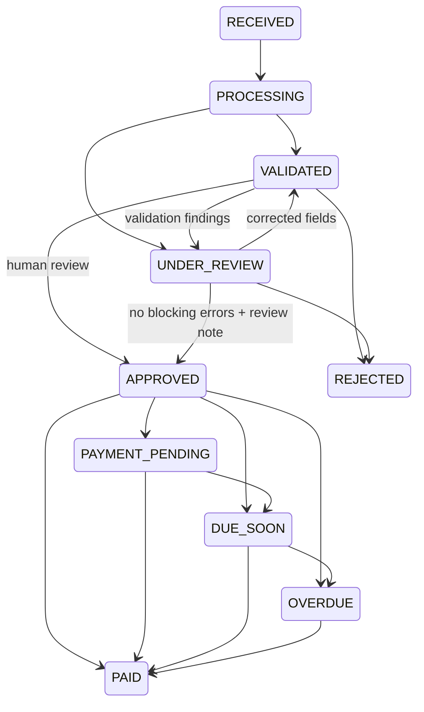

# Architecture and business invariants

## Boundary of responsibility

n8n owns Gmail/Drive OAuth, scheduling, binary transport, and email sending. FastAPI owns all financial rules, identity, status transitions, database transactions, and notification deduplication. The React client never writes the database directly. No LLM output can initiate an email or payment action.

## Data model

`invoices` has one-to-many `invoice_items`, `audit_logs`, `reminders`, and `processing_jobs`. All child rows use indexed foreign keys. Items are replaced transactionally when an invoice is edited. `vendors` is a normalized-name directory; invoice rows preserve the vendor details as an immutable historical snapshot after approval. `users` stores only password hashes. Monetary fields are NUMERIC(18,2), quantity/unit price NUMERIC(18,4). JSON stores validation findings and confidence; date columns are business dates, timestamps are UTC.

The initial Alembic revision contains explicit DDL, independent of future model changes. Tests use SQLite for speed; production uses PostgreSQL for row-level locking and transactional uniqueness guarantees.

## Ingestion and failures

1. Reserve a unique SHA-256 idempotency key over Gmail message ID, attachment ID, filename and bytes.
2. Commit RECEIVED audit and PROCESSING invoice/job before expensive work.
3. Extract PDF text or OCR pages/images. Validate upload extension and decoded document structure.
4. Extract via local Ollama (`llama3.2`, the default) using `/api/chat` with a JSON schema, or an explicitly configured alternative provider. Parse with Pydantic. Docker accesses host Ollama through `host.docker.internal:11434`; the standalone Python server uses localhost. No cloud API key is needed for Ollama.
5. Apply validation, populate line items and vendor directory, write audit entries, finish the job.
6. On processing failure, roll back partial extraction and persist an UNDER_REVIEW invoice, HIGH risk, failed job and sanitized error.

A retry returns the reserved invoice, including a failed or processing record. It does not silently rerun extraction. Review/edit the invoice to repair it. A process crash requires stale-job reconciliation as documented in operations. This avoids duplicate processing without pretending synchronous requests are a full queue.

## Duplicate handling

- Transport identity: unique `idempotency_key` prevents a retried attachment from creating another invoice; two attachments in one message remain distinct.
- Business identity: normalized vendor name plus the *exact* invoice number produces a unique canonical `business_key`.
- A separate duplicate document remains visible as UNDER_REVIEW/HIGH with no canonical key; approval is blocked until resolved. It can be rejected without hiding the evidence.
- A concurrent canonical-key/vendor insert conflict fails safely to review or returns a conflict, rather than allowing two payable canonical records.
- Secondary similarity: normalized vendor + equal total + invoice date, excluding the current invoice, produces a review reason.

Vendor names are not strong legal identities. Tax identifiers and bank-account verification would be sensible real-deployment extensions.

## Rules and state machine

Payable invoices may also be rejected; paid/rejected are terminal. Monitoring may recalculate payable date states, but never promotes unapproved invoices. Only UNDER_REVIEW and VALIDATED records are editable; any edit revalidates. A repeated same-state request is a no-op with no duplicate audit.

Missing required fields, invalid dates, inconsistent/negative totals and canonical duplicates are blocking errors and HIGH risk. Missing PO, unknown arithmetic components, high value, similarity, extraction warnings, or missing/low important-field confidence require review. Any blocking error, more than five times the configured high-value threshold, or four or more findings yields HIGH; otherwise findings yield MEDIUM, no findings LOW. Thresholds apply in the preserved invoice currency; there is no implied foreign-exchange conversion.

## Reminder delivery semantics

The morning workflow refreshes payable states, then claims notifications. A unique constraint covers invoice + reminder type + business date. Claiming commits a RESERVED row before Gmail is called. Only Gmail success followed by acknowledgement sets SENT and `sent_at` and writes `reminder_sent`. Gmail sends have no automatic retry, because a timeout can follow a successful delivery. Acknowledgement itself is idempotent and retryable.

This favors preventing duplicate sends over guaranteed delivery. Reserved notifications with ambiguous outcomes require a human to reconcile Gmail Sent. It is not mathematically exactly-once delivery. Risk alerts are also limited to one reservation per day, and only for HIGH invoices still in review.

## Reporting and security

Values are grouped by exact currency; the UI never sums INR and USD. Overdue trend reconstructs outstanding invoices from due dates, creation times and paid timestamps and excludes currently rejected invoices. It is an operational trend, not a complete historical accounting ledger (rejection history is not reconstructed).

Human routes use Argon2-backed JWT authentication. Automation routes use a constant-time header-key comparison. Automation cannot approve/reject/edit invoices; it can process attachments, monitor, claim/acknowledge reminders, and record confirmed payments. The webhook has a separate credential. Login throttling is in-process for this single-worker deployment. Tokens expire and are stored in browser session storage; a hardened deployment should consider an HTTP-only cookie/BFF, CSP and central session control.
